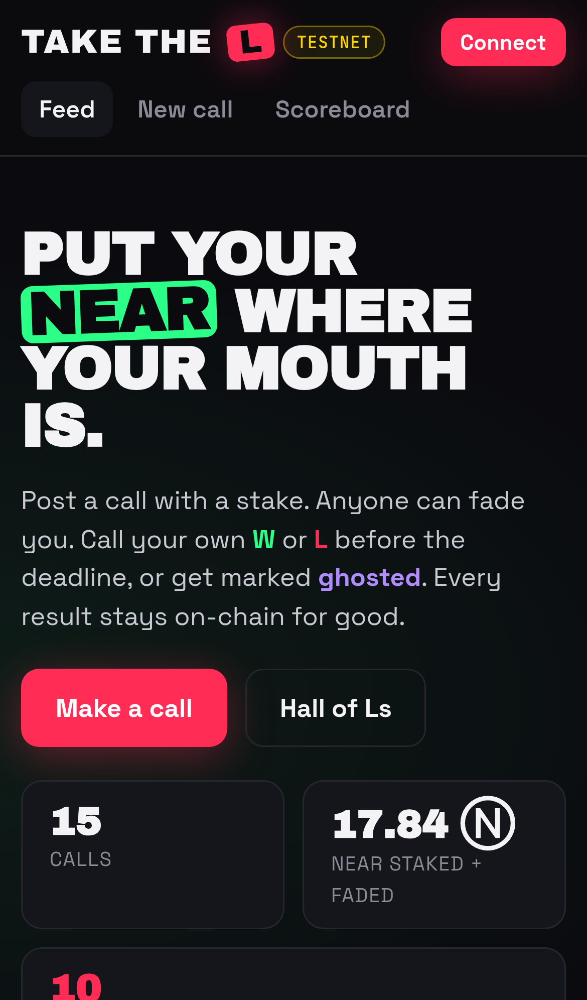
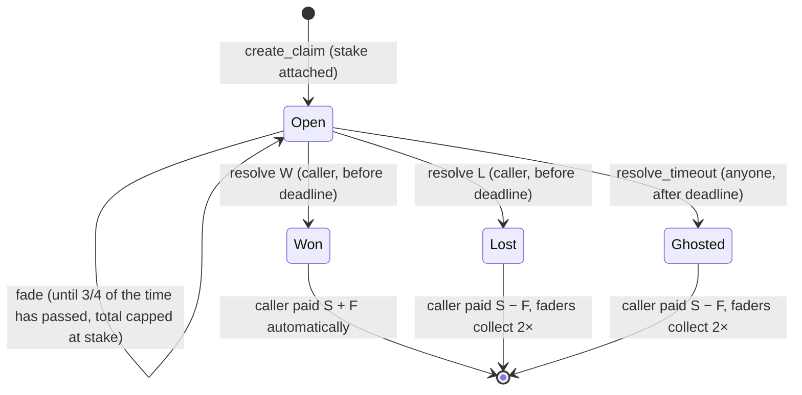

# Take the L

**Take the L puts money and a permanent record behind crypto-Twitter calls on NEAR.** A caller stakes NEAR on a claim ("$NEAR 2x by Friday") with a deadline. Anyone can bet against it ("fade" it). The caller settles their own call as W or L before the deadline. A caller who stays silent past the deadline is settled as an L and marked **ghosted**. Every call, result and ghosting is stored in a NEAR smart contract, and the app builds public profiles and a scoreboard from that record.

Built at **NEAR HACKATHON 2026**. Tracks: **Social Money** (`social`) and **Open Innovation** (`open`). Status: working prototype on **NEAR testnet**.

| | |
|---|---|
| Live app (testnet, works on phones) | **https://take-the-l-near.vercel.app** · mirror: https://0xziggy19.github.io/take-the-l/ |
| Contract (testnet) | [`takethel-eadf0a.testnet`](https://testnet.nearblocks.io/address/takethel-eadf0a.testnet) |
| Example Sputnik DAO player | [`ttlcrew.sputnikv2.testnet`](https://testnet.nearblocks.io/address/ttlcrew.sputnikv2.testnet): it faded a call, collected 2× into its treasury, and posted live call [#11](https://take-the-l-near.vercel.app/#/claim/11) |
| X demo post | Added at submission |
| Repository | https://github.com/0xZiggy19/take-the-l |
| Design notes | [docs/DESIGN.md](docs/DESIGN.md) |
| Recorded testnet runs | [docs/testnet-demo.md](docs/testnet-demo.md) (CLI), [docs/dao-demo.md](docs/dao-demo.md) (DAO), [docs/e2e-results.json](docs/e2e-results.json) (browser) |
| Screenshots | [docs/screenshots/](docs/screenshots/) |



---

## 1. The problem

- Calls on crypto Twitter are free to make. "$X 10x by Friday" gets posted, and when it misses, the post is deleted or ignored.
- Nobody keeps score. Followers see the hits and miss the misses, so they can't tell a good caller from engagement farming.
- Betting against a caller today means a side bet in DMs with an escrow you have to trust, or nothing at all.

**Take the L makes a call cost something and makes the result impossible to delete.** The stake prices the conviction. The on-chain record is the reputation. Fades give anyone who disagrees a way to act on it.

## 2. Why NEAR

| NEAR feature | How Take the L uses it |
|---|---|
| Smart contract that holds funds | Stakes and fades sit in a contract with no owner and no admin methods. Money leaves only by the payout rules below. |
| Low fees | Measured on testnet: `create_claim` burned about 0.00026 NEAR in gas, `fade` about 0.00027, `resolve` about 0.00039 and `collect` about 0.00043. Storage for a new call (about 0.003 NEAR) is deducted from the deposit. That makes a 0.1 NEAR minimum stake practical. |
| Named accounts | `alice.near`-style names are the identity layer. Profiles and the scoreboard are keyed by account, and a caller can attach an X handle. |
| Function-call access keys | Signing in with Wallet Selector adds a key that can only call this contract. Calls with no deposit (`resolve`, `resolve_timeout`, `collect`) can be signed with that key, usually without a wallet popup. Calls that move NEAR in (`create_claim`, `fade`) always go to the wallet for approval. |
| Composability with Sputnik DAO | A DAO can be a caller or a fader with no special code. Its members vote on a `FunctionCall` proposal, the contract sees the DAO as the sender, and winnings return to the DAO treasury. |
| Public RPC views | The feed, call pages, profiles and scoreboard read the contract directly over public JSON-RPC. No indexer or backend is needed, and no wallet is needed to browse. |
| Events | Every state change emits a NEP-297 `EVENT_JSON` log, so an indexer can rebuild the history. |

## 3. How it works

### Lifecycle

1. **Call.** `create_claim(text, duration_minutes, x_handle?, x_link?)` with NEAR attached. Storage is deducted, and the rest becomes the stake **S** (at least 0.1 NEAR). Text is up to 280 characters. The deadline can be 1 minute to 365 days away; the app offers 1, 3 and 10 minutes for demos, plus 1 hour, 1 day, 1 week and 30 days.
2. **Fade.** `fade(claim_id)` with NEAR attached, by anyone except the caller. Total fades **F** are capped at **S**, and anything over the cap is refunded in the same transaction. A call can have up to 50 faders.
3. **Fade cutoff.** Fades close once **3/4 of the time to the deadline** has passed (`created_at + 3/4 × (deadline − created_at)`). Nobody can fade in the last stretch, when the outcome is already obvious.
4. **Settle.** Before the deadline, only the caller can call `resolve(claim_id, "W" | "L")`, once. The caller's payout is sent in the same transaction.
5. **Ghosted.** After the deadline the caller can no longer resolve. **Anyone** can call `resolve_timeout(claim_id)`, which settles the call as an L and adds 1 to the caller's `ghosted` count.
6. **Collect.** After an L or a ghosting, each fader calls `collect(claim_id)` to receive 2× their fade.

### Payouts (S = caller stake, F = total fades ≤ S, f = one fader's fade)

| Outcome | Caller receives | Each fader receives |
|---|---|---|
| **W** | S + F | 0 |
| **L** or **Ghosted** | S − F | 2 × f |
| Nobody faded | S (refund, W or L) | – |

It's an even-money bet on the matched amount. Only F of the caller's stake is at risk, and the unmatched S − F always comes back. Payouts are integer-exact (no division) and always add up to S + F.

### States



### Trust model

- **No oracle and no admin.** The caller decides W or L. The contract enforces only the money rules and the timing.
- **Social accountability.** Every call, its stake, its faders, its result and its settlement time stay on-chain and can't be edited. Faders decide whom to fade by reading the caller's public record.
- **Silence doesn't help.** A caller who doesn't settle in time is settled as an L and gets a permanent 👻.
- **Bounded risk.** Fades are capped at the stake, so both sides risk the same amount. The fade cutoff removes last-minute sniping.
- **Safe payouts.** Each claim settles once. "Paid" flags are set before a transfer, and a private `on_payout` callback re-opens the balance if a transfer fails. Storage is paid by whoever adds the data.

### Limitations (honest)

- A caller **can** mark a false W. The design makes that visible and permanent, not impossible. An oracle or dispute layer is out of scope.
- Testnet only. Stakes are in NEAR, with no stablecoin or NEP-141 support.
- The contract has no upgrade method, but during the hackathon the testnet contract account still holds its deploy key. It was used once, on 2026-11-10, for a code-only upgrade that added the fade cutoff and kept all state. A mainnet deploy would delete that full-access key.
- The app loads all calls and profiles through paged view calls (100 per page). That's fine at prototype scale; a larger deployment would want an indexer, and the contract's events already support one.
- The app uses hash routing, so every shared link shows the same social preview card, not one per call.
- A call made by a DAO must be settled by a DAO vote before its deadline, or anyone can settle it as ghosted.

---

## 4. Try it in 3 minutes (hosted app, phone or desktop)

**You need:** a free NEAR **testnet** account with a little free testnet NEAR. No real money is involved anywhere. Steps 1–5 need no wallet.

**Getting free testnet NEAR**
1. Create a testnet account (name ends in `.testnet`) in a wallet, for example https://testnet.mynearwallet.com.
2. Open the official NEAR faucet at https://docs.near.org/getting-started/faucet, enter your `.testnet` account, and tap **Request**. You'll receive free testnet NEAR. If it's rate-limited or empty, use https://near-faucet.io instead.
3. 1 testnet NEAR is plenty. A fade is at least 0.01 NEAR and a call at least 0.1 NEAR, plus well under 0.01 NEAR of gas and storage.

**About connecting your wallet.** Connecting adds a small "function-call" access key to your account that can only call this contract, so no-deposit actions (W, L, ghost, collect) don't need a wallet popup. Adding that key is itself a transaction, so your account needs a little testnet NEAR for gas (a tiny fraction of 1 NEAR) before you connect. MyNearWallet shows an **allowance of 0.25 NEAR** on that key: that is the maximum the key may spend on gas over its lifetime, **not** an upfront charge. Nothing is deducted until a transaction actually burns gas. Calls that move NEAR (create, fade) always open the wallet for your approval.

| # | Do | See |
|---|---|---|
| 1 | Open **https://take-the-l-near.vercel.app** | A dark feed with a yellow **TESTNET** badge, stats (calls, NEAR staked + faded, Ls taken) and call cards with **LIVE / W / L / GHOSTED** badges and a yellow-vs-blue stake/fade bar. |
| 2 | Tap the **L** filter chip | Only cards with a red **L** badge remain. |
| 3 | Open any L card | The call text, "L taken. Faders split X Ⓝ", and each fader with "→ wins" 2× their fade. |
| 4 | Tap **Scoreboard**, then the **Ghosts** and **Top faders** tabs | "Ls taken" ranks callers by Ls plus ghosts. **Top faders** lists `ttlcrew.sputnikv2.testnet` with a blue **DAO** tag. Tap a name to open a profile with its **W / L / 👻** record and hit rate. |
| 5 | Open call **#11**, the DAO's live call (https://take-the-l-near.vercel.app/#/claim/11) | "Community call: $NEAR above $5 before Dec 1" by `ttlcrew.sputnikv2.testnet` (DAO tag), a **LIVE** badge, a countdown, and "Fades close in …". Fades on #11 are open until **2026-11-20 19:55 UTC**; the deadline is 2026-11-24 07:55 UTC. |
| 6 | Tap **Connect** (top right), choose MyNearWallet (or Meteor, HOT, Intear), sign in with your testnet account | The header shows your account name and **Sign out**. |
| 7 | On #11, pick the **0.1 Ⓝ** chip, tap **Fade it for 0.1 Ⓝ**, approve in the wallet | A green "Faded. Now you wait." toast with a **view tx ↗** link. The blue bar grows, and your account appears under **Faders**. |
| 8 | Tap **Share on 𝕏** on any call | An x.com post composer opens with text that matches the call's state and a link back to the call. |

**Full loop with your own call (about 5 minutes, two testnet accounts, for example two browser profiles):**

| # | Do | See |
|---|---|---|
| 9 | Account A: **New call** → type `$NEAR 2x by Friday`, stake `0.5`, deadline **3 min** → **Stake it** → approve | You land on the new call page: **LIVE** badge, countdown, "Fades close in 2m …". |
| 10 | Account B: open that call, enter `0.2`, tap **Fade it for 0.2 Ⓝ** within the first 2m 15s | The bar grows and B appears under Faders. After the cutoff the form is replaced by "Fading is closed for the last quarter of a call's time…". |
| 11 | Account A: tap **I take the L** | The badge turns into a red **L**, and A's unmatched stake comes back. |
| 12 | Account B: reload the call | A **Collect ≈0.4 Ⓝ** button appears (2× the fade after the small storage fee). Tap it: a "Collected. Enjoy." toast, and the button disappears. |
| 13 | Account A: make another call with a **1 min** deadline and don't settle it | When the countdown hits 0, any signed-in account sees a purple **Settle as GHOSTED 👻** button. Tap it: the badge turns to **GHOSTED**, and A's profile shows one more 👻. |

### No wallet, no browser: read the contract with near-cli

Install [near-cli-rs](https://github.com/near/near-cli-rs), then:

```bash
C=takethel-eadf0a.testnet
near contract call-function as-read-only $C get_claim json-args '{"claim_id":11}' network-config testnet now
```
You should see JSON like this (fields trimmed):
```json
{
  "caller": "ttlcrew.sputnikv2.testnet",
  "fades": [],
  "id": 11,
  "stake": "997310000000000000000000",
  "status": "Open",
  "text": "Community call: $NEAR above $5 before Dec 1",
  "total_faded": "0"
}
```
`fades` and `total_faded` grow as people fade it. Amounts are in yoctoNEAR (10^24 = 1 NEAR).

```bash
near contract call-function as-read-only $C get_profile json-args '{"account_id":"ttlcrew.sputnikv2.testnet"}' network-config testnet now
```
You should see `"calls": 1, "fades": 1, "wins": 0, "losses": 0, "ghosted": 0`, plus `total_staked` and `total_faded`.

```bash
near contract call-function as-read-only $C list_claims json-args '{"limit":3}' network-config testnet now
```
You should see the 3 newest claims, each with a `status` of `Open`, `Won`, `Lost` or `Ghosted`.

---

## 5. Run and verify it yourself

**Prerequisites:**
- Rust 1.95 (pinned in `rust-toolchain.toml`, with the `wasm32-unknown-unknown` target)
- [cargo-near](https://github.com/near/cargo-near) 0.23
- [near-cli-rs](https://github.com/near/near-cli-rs) 0.31
- Node 24 with npm 11
- Google Chrome, for the headless end-to-end tests

Every command below was run on 2026-11-10 against the code in this repo.

```bash
git clone https://github.com/0xZiggy19/take-the-l && cd take-the-l
```

| Do | See |
|---|---|
| `cargo test --lib` | `test result: ok. 28 passed`. These cover the W, L, ghost and no-fade payouts, the fade cap and refund, the fade cutoff (allowed at 7 of 10 minutes, rejected at 7.5, caller can still settle), double resolve and double collect, resolve by a non-caller, early timeout, input validation, the failed-payout restore and paging. |
| `cargo test --test integration -- --test-threads=2` | `test result: ok. 5 passed` (`happy_w_path`, `happy_l_path`, `no_fade_refund`, `timeout_counts_as_l`, `rejections`). They run on a local NEAR sandbox node and check real balances after each payout. The first run downloads the sandbox and takes a few minutes. |
| `cargo near build non-reproducible-wasm` | `target/near/take_the_l.wasm` (about 200 KB) and its ABI. |
| `near contract deploy <you>.testnet use-file target/near/take_the_l.wasm with-init-call new json-args '{}' prepaid-gas '100.0 Tgas' attached-deposit '0 NEAR' network-config testnet sign-with-keychain send` | Your own copy of the contract, deployed with empty state. |
| `cd web && npm ci && npm run dev` | Vite prints `http://localhost:5173/`. Open it to get the same app as the hosted one, pointed at `takethel-eadf0a.testnet`. |
| `npm run build` (in `web/`) | A static site in `web/dist/`. It uses relative paths and hash routes (`/#/claim/7`), so any static host works. To point it elsewhere, set `VITE_CONTRACT_ID=<acct>.testnet` (also `VITE_NETWORK`, `VITE_RPC_URLS`). |

**Scripted runs on testnet.** These use your own faucet accounts. Keys live in `~/.near-credentials` and never in the repo.

```bash
for n in caller fader1 fader2; do near account create-account sponsor-by-faucet-service $n-$USER-ttl.testnet autogenerate-new-keypair save-to-legacy-keychain network-config testnet create; done
export CONTRACT=takethel-eadf0a.testnet CALLER=caller-$USER-ttl.testnet FADER1=fader1-$USER-ttl.testnet FADER2=fader2-$USER-ttl.testnet
```

| Do | See |
|---|---|
| `./scripts/demo-testnet.sh` (about 3 minutes) | One line per transaction: `OK` or `FAILED`, with a nearblocks link. It runs a W path, an L path with an over-fade (capped and refunded) and 2× collects, a no-fade refund, and a ghosted call. Every `FAILED` line is a deliberate rejection labelled `REJECT …`, followed by the contract's panic message: fading your own call, a resolve by a non-caller, a double resolve, an early timeout, a fade after the cutoff and deadline, a resolve after the deadline, and a collect after a W. A recorded run is in [docs/testnet-demo.md](docs/testnet-demo.md). |
| `DAO_NAME=ttl-$USER ./scripts/dao-demo.sh` (about 1 minute; FADER1 needs about 9 testnet NEAR) | It creates a Sputnik DAO through `sputnikv2.testnet` with FADER1 and FADER2 as the council. The DAO fades a call by proposal and two votes (`"status": "Approved"`), the caller takes the L, and the DAO collects ("claimable after: \"0\""). Then the DAO posts its own LIVE call. A recorded run is in [docs/dao-demo.md](docs/dao-demo.md). |
| `cd web && npm run build:e2e && (npx vite preview --outDir dist-e2e --port 4174 &) && BASE=http://localhost:4174 npm run e2e` | Headless Chrome drives the real UI against testnet: `24/24 passed`. It covers create, fade, W, an over-fade capped at the stake, L and collect, the fade form closing at the cutoff, ghosting, the read-only feed, filters, the scoreboard, profiles, share links and the mobile layout. The results go to `docs/e2e-results.json`, with tx links, and the screenshots to `docs/screenshots/`. |
| `npx vite preview --port 4173 &` then `BASE=http://localhost:4173 npm run e2e:wallet` (in `web/`, after `npm run build`) | `"found": ["MyNearWallet", "Meteor Wallet", "HOT Wallet", "Intear Wallet"]` and `"pageErrors": []`. |
| `BASE=http://localhost:4173 ENGINES=chromium npm run e2e:tx` (same preview server) | Regression test for wallet transactions in the production build, with Node globals (`Buffer`, `process`, `global`) removed from the page. It uses a fake MyNearWallet session with a random throwaway key: fade and create must open the MyNearWallet `/sign` popup with a decodable transaction, and "I take the L" must be signed locally with the function-call key (the send is intercepted and never reaches the chain). Expect `"passed": 10, "total": 10`. Add `webkit` to `ENGINES` to also run it in Safari's engine if Playwright WebKit is installed. Nothing is signed for real and no NEAR moves. |

The e2e build (`VITE_E2E_KEY_SIGNER=1`) signs with test keys that the test runner reads from `~/.near-credentials` at runtime. That code is not included in the normal `npm run build`.

---

## 6. Reference

### Repo map

```
src/lib.rs                contract (state, payout rules, events)
src/tests.rs              28 unit tests
tests/integration.rs      5 sandbox tests (near-sandbox + near-api)
scripts/demo-testnet.sh   CLI end-to-end run on testnet, including rejection checks
scripts/dao-demo.sh       Sputnik DAO as fader and caller on testnet
web/src/                  React app: pages/ (Feed, Create, ClaimPage, Profile, Board), near/ (rpc, wallet)
web/e2e/                  headless browser tests (flows.mjs, wallet-modal.mjs, wallet-tx.mjs)
docs/                     design notes, recorded runs, screenshots, demo video credits
.github/workflows/        CI: cargo fmt, clippy, cargo test, web build
```

### Contract API (`takethel-eadf0a.testnet`)

| Method | Who | Deposit | Effect |
|---|---|---|---|
| `create_claim(text, duration_minutes, x_handle?, x_link?) → u64` | anyone | stake + storage (≥ 0.1 NEAR stake) | New Open claim. Returns its id. |
| `fade(claim_id) → NearToken` | anyone but the caller | fade + storage (≥ 0.01 NEAR) | Adds a fade up to the cap and refunds the excess. Returns the accepted amount. |
| `resolve(claim_id, "W" \| "L")` | caller, before the deadline | 0 | Settles the claim and pays the caller. |
| `resolve_timeout(claim_id)` | anyone, after the deadline | 0 | Settles as Ghosted (an L) and pays the caller S − F. |
| `collect(claim_id)` | a fader after an L or Ghosted (or the caller if their auto-payout failed) | 0 | Pays 2× the fade (or the caller's amount). |
| `get_claim`, `list_claims(from_index?, limit?, newest_first?)`, `get_claims_count`, `list_claims_by_caller`, `list_claims_by_fader` | view | – | Claims, newest first. Pages are up to 100. |
| `get_profile(account_id)`, `list_profiles(from_index?, limit?)` | view | – | `calls, wins, losses, ghosted, total_staked, total_faded, fades`. |
| `get_claimable(claim_id, account_id)` | view | – | What `collect` would pay right now. |

**Events** (`EVENT_JSON`, `standard: "takethel"`, `version: "1.0.0"`):
- `claim_created`: claim_id, caller, text, stake, deadline, storage_cost
- `claim_faded`: claim_id, fader, amount, refund, total_faded
- `claim_resolved`: claim_id, caller, status, resolved_by, stake, total_faded, caller_payout
- `payout_collected`: fader collects; claim_id, account, amount

### Libraries and tools

- **Contract:** `near-sdk` 5.30.1, built with `cargo-near` 0.23.0 on Rust 1.95. Tests use `near-sandbox` 0.4, `near-api` 0.8, `cargo-near-build` 0.11, `tokio` and `testresult`.
- **Frontend:**
  - `react` and `react-dom` 19.3, `react-router-dom` 7.18, `vite` 8.3 and `typescript` 7.0
  - `@near-wallet-selector/*` 10.1.4: core, modal-ui, my-near-wallet, meteor-wallet, hot-wallet and intear-wallet
  - `near-api-js` 7.4, used only by the e2e signer and the tests
  - `buffer` 6.0.3: installs a browser `Buffer` before any wallet code loads (`web/src/polyfills.ts`), because the wallet libraries expect Node's global `Buffer`
  - Fonts via `@fontsource`: Archivo Black, Space Grotesk and JetBrains Mono
- **Tooling:** `near-cli-rs` 0.31.1, `playwright-core` 1.65 with Google Chrome, and `oxlint`.
- **On-chain dependency:** the Sputnik DAO v2 factory `sputnikv2.testnet` ([near-daos/sputnik-dao-contract](https://github.com/near-daos/sputnik-dao-contract)), used only by `scripts/dao-demo.sh`.
- **Starting points:** the scaffold came from `cargo near new` and `npm create vite` (react-ts). No other templates.

### AI-generated code disclosure

All code and docs in this repo were **generated by an AI coding agent**: the contract, tests, frontend, scripts, README, design notes, social preview image and demo video assets. The team lead (solo, non-coder) chose the idea and made the product decisions. Everything was written on 2026-11-10, inside the hackathon window (2026-10-19 to 2026-11-14). There is no pre-hackathon baseline, and this is the team's only project in the hackathon.

### Track fit

- **Social Money (`social`):** a money-backed, public reputation record for callers, with programmable rewards (faders are paid 2× by rule, with no middleman). Communities can run it from a **Sputnik DAO** treasury as a shared fade fund, voting on each fade and collect. This is shown on testnet in [docs/dao-demo.md](docs/dao-demo.md). Trezu is not integrated.
- **Open Innovation (`open`):** a self-resolved call with no oracle, where honesty is enforced by a permanent public record and the ghosting rule.

### License

MIT, see [LICENSE](LICENSE).
