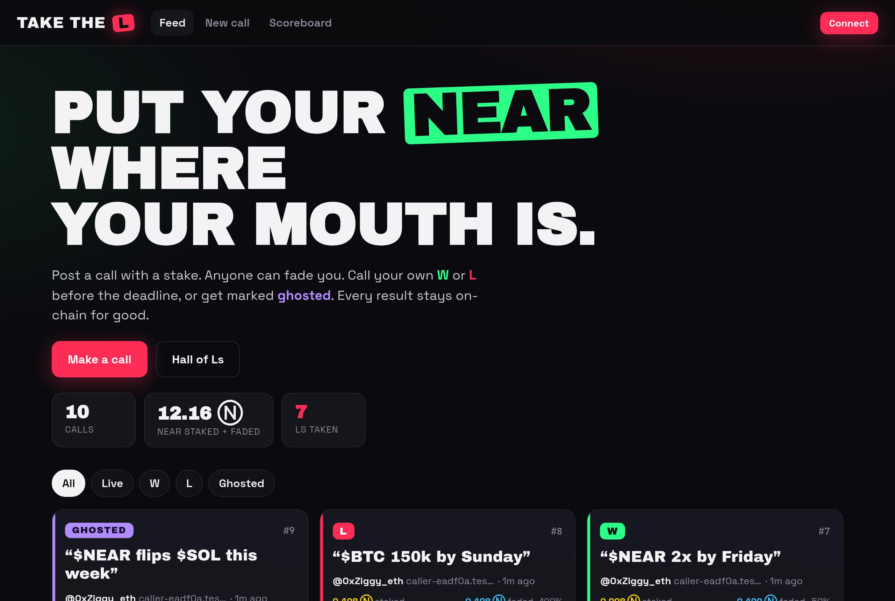

# Take the L

**Crypto-Twitter calls with skin in the game.** Anyone can post a call ("$NEAR 2x by Friday") with a NEAR stake. Anyone else can *fade* it by putting NEAR against it. The caller marks their own **W** or **L** before the deadline. If they go quiet, anyone can settle the call as an L and the caller is marked **ghosted**. Every call, result and ghosting is recorded permanently in a NEAR smart contract, and the scoreboard is built from that record.

Built at **NEAR HACKATHON 2026**. Track: **Social Money** (`social`).

| | |
|---|---|
| Live contract (testnet) | [`takethel-eadf0a.testnet`](https://testnet.nearblocks.io/address/takethel-eadf0a.testnet) |
| Hosted app | [0xziggy19.github.io/take-the-l](https://0xziggy19.github.io/take-the-l/) (NEAR testnet) |
| Demo video / X post | _TBD_ |
| Contract design | [docs/DESIGN.md](docs/DESIGN.md) |
| Recorded testnet runs | [docs/testnet-demo.md](docs/testnet-demo.md), [docs/e2e-results.json](docs/e2e-results.json) |
| Screenshots | [docs/screenshots/](docs/screenshots/) |



## The problem

On CT, calls cost nothing. People post "$X 10x by Friday" and quietly delete it when it misses. Accounts with no track record grow on the calls that happened to land, and nobody keeps score on the rest. Followers can't tell conviction from engagement farming.

## What it does

1. **Make a call.** Write the claim (280 characters max), pick a stake, and pick a deadline. Deadlines run from 1 minute (for demos) to 30 days in the UI, and up to 365 days in the contract. You can add your X handle and a link to the original post.
2. **Fade it.** Anyone except the caller can put NEAR against the call, up to the caller's stake. This makes every call an even-money 1:1 bet. Anything over the cap is refunded in the same transaction.
3. **Settle it.** Before the deadline, the caller presses **"I called it: W"** or **"I take the L"**.
4. **Ghosted.** Once the deadline passes, the caller can't settle the call any more. **Anyone** can press "Settle as GHOSTED", which pays out as an L and adds a permanent ghost to the caller's record.
5. **Get paid.** The caller's payout is sent automatically when the call is settled. Faders press **Collect**, and the app shows exactly how much they can claim.
6. **Scoreboard.** Each profile shows its W / L / 👻 record, hit rate, total staked and fade history. The **"Ls taken"** leaderboard ranks callers by L's taken plus ghosts, and there are tabs for Most Ws, Ghosts and Top faders.
7. **Share on 𝕏.** Every call has an `x.com/intent/post` button that prefills text for the call's current state (live, W, L or ghosted) and links back to the call.

### Payout rules (S = caller stake, F = total fades ≤ S, f = one fade)

| Outcome | Caller receives | Each fader receives |
|---|---|---|
| **W** | S + F | 0 |
| **L** or **Ghosted** | S − F | 2 · f |
| Nobody faded | S (W or L) | – |

Only the matched part of the stake is at risk. Both sides risk the same amount for the same reward. Payouts are exact (no division, no rounding dust) and always add up to S + F. See [docs/DESIGN.md](docs/DESIGN.md).

### Trust model (read this)

There is **no oracle**, and that is deliberate. A caller *can* lie and mark a false W. What they can't do is hide it:
- Every call, its stake, who faded it, the result and the time it was settled stays on-chain and can't be edited.
- Not settling in time doesn't let a caller escape the result: the call is settled as an L and they get a permanent 👻.
- Faders decide who to fade by looking at the caller's public record.

The product is the record. Money makes posting a call cost something, and the record makes lying cost something too.

## How NEAR is used

- **A self-custodial contract with no admin** (Rust, `near-sdk` 5.30). The contract has no owner, no admin methods and no upgrade path. Funds can only leave through the payout rules above.
- **Attached deposits.** Stakes and fades are `#[payable]` calls with the NEAR attached. Storage is paid by the user who adds the data: the contract measures `env::storage_usage()` before and after the write and deducts that cost from the deposit.
- **Promise transfers with callbacks.** Payouts are `Promise::transfer`s, each followed by a `#[private]` `on_payout` callback. If a transfer fails, the callback makes the amount claimable again. The "paid" flags are set before the transfer, so nothing can be paid twice.
- **Pull payments.** The caller is paid automatically, and faders `collect`. Each call takes a fixed amount of gas however many faders a claim has (up to 50).
- **Events.** NEP-297 `EVENT_JSON` logs (`claim_created`, `claim_faded`, `claim_resolved`, `payout_collected`) are emitted for indexers.
- **Named accounts.** Named accounts (`alice.testnet`) are the identity layer: profiles and scoreboards are keyed by NEAR account, and callers can attach an X handle.
- **Logged-out reads.** Read-only views (`list_claims`, `get_claim`, `get_profile`, `list_profiles`, `get_claimable`, …) go straight to public JSON-RPC, so the feed, call pages and scoreboard work **without a wallet**.
- **NEAR Wallet Selector.** The app connects through Wallet Selector with MyNearWallet, Meteor, HOT and Intear. Sign-in requests a function-call key for the contract, so calls that attach no deposit (resolve, collect, settle-as-ghosted) can be signed by the key the wallet creates at sign-in, usually without another prompt. Calls that attach NEAR are approved in the wallet.

## Try it (judges): do X, see Y

Everything below runs against the **live testnet contract** `takethel-eadf0a.testnet`. You need Node 20+ for the app. A NEAR testnet wallet is optional.

### A. In the app (about 2 minutes)

```bash
git clone <this repo> && cd take-the-l/web
npm install
npm run dev            # open the printed http://localhost:5173
```

1. **Open the feed.** You should see existing calls with LIVE / W / L / GHOSTED badges, a stake-vs-faded bar on each card, and the stats at the top. No wallet is needed.
2. **Click the `L` filter chip.** Only calls with a red **L** badge should remain.
3. **Open any L call.** You should see the call text, the "L taken. Faders split X Ⓝ" verdict, and each fader's amount with "→ wins 2×".
4. **Click "Share on 𝕏".** An x.com post composer should open, prefilled with "… took the L 🫡 …" and the link to the call.
5. **Open Scoreboard → "Ls taken".** You should see `caller-eadf0a.testnet` ranked with its L and ghost counts. Click it to open the profile with its **W / L / 👻** record and hit rate.
6. **Click Connect.** The NEAR Wallet Selector should open with MyNearWallet, Meteor, HOT and Intear. Sign in with a testnet account. You can get one for free at https://testnet.mynearwallet.com.
7. **Go to New call.** Enter `$NEAR 2x by Friday`, stake `0.5`, deadline `3 min`, and click **Stake it**. After you approve in the wallet, you should land on the new call page with a **LIVE** badge and a running countdown.
8. **Fade the call from a second account** (another browser profile): enter `0.2` and click **Fade it**. The blue faded bar should grow, and the fader should appear in the list.
9. **As the caller, click "I take the L".** The badge should turn into a red **L** and the caller's unmatched stake should come back. As the fader, a **Collect 0.4 Ⓝ** button should appear. Click it and the button should disappear once you've been paid.
10. **Make another call with a `1 min` deadline and don't settle it.** When the countdown hits 0, a purple **"Settle as GHOSTED 👻"** button should appear for anyone. Click it: the badge should turn to **GHOSTED** and the caller's 👻 count should go up.

### B. With near-cli only (no browser)

```bash
# install: https://github.com/near/near-cli-rs
C=takethel-eadf0a.testnet
near contract call-function as-read-only $C list_claims json-args '{"limit":5}' network-config testnet now
near contract call-function as-read-only $C get_profile json-args '{"account_id":"caller-eadf0a.testnet"}' network-config testnet now
```
You should see JSON claims with `status` set to `Open`, `Won`, `Lost` or `Ghosted`, and a profile with `wins`, `losses` and `ghosted` counts.

To run the full W / L / ghosted / rejection scenario with your own faucet accounts (takes about 3 minutes):
```bash
for n in caller fader1 fader2; do near account create-account sponsor-by-faucet-service $n-$USER-ttl.testnet autogenerate-new-keypair save-to-legacy-keychain network-config testnet create; done
CONTRACT=$C CALLER=caller-$USER-ttl.testnet FADER1=fader1-$USER-ttl.testnet FADER2=fader2-$USER-ttl.testnet ./scripts/demo-testnet.sh
```
Every line should print `OK` or `FAILED` with a nearblocks link. The `FAILED` lines are the deliberate rejection checks: a double resolve, a fade on your own call, a resolve by someone who isn't the caller, a fade after the deadline, a collect after a W, and an early timeout. Each one shows the contract's panic message.

### C. Contract tests

```bash
cargo test --lib                                  # 25 unit tests
cargo test --test integration -- --test-threads=2 # 5 sandbox tests on a real local NEAR node
```
All 30 tests should pass. They cover the happy W and L paths, timeout as L, the no-fade refund, double resolve, a resolve by someone who isn't the caller, a fade after the deadline, the fade cap with refund, double collect, a failed-payout restore and the private callback.

## Run it locally

| What | Command |
|---|---|
| Contract build | `cargo near build non-reproducible-wasm` → `target/near/take_the_l.wasm` |
| Deploy your own copy | `near contract deploy <acct>.testnet use-file target/near/take_the_l.wasm with-init-call new json-args '{}' prepaid-gas '100.0 Tgas' attached-deposit '0 NEAR' network-config testnet sign-with-keychain send` |
| Web dev server | `cd web && npm install && npm run dev` |
| Web production build | `cd web && npm run build` → static files in `web/dist/` |
| Point the app at another contract | `VITE_CONTRACT_ID=<acct>.testnet npm run build` (also `VITE_NETWORK`, `VITE_RPC_URLS`) |
| Headless UI end-to-end test | `npm run build:e2e && npx vite preview --outDir dist-e2e --port 4174 &` then `BASE=http://localhost:4174 CALLER=… FADER1=… FADER2=… npm run e2e` |

`web/dist` is a plain static site. It uses `base: "./"` and hash routing (`/#/claim/7`), so it works from any host and any sub-path with no rewrite rules.

**About the E2E build:** it is compiled with `VITE_E2E_KEY_SIGNER=1` and signs with testnet keys read from `~/.near-credentials` at runtime, so headless Chrome can drive every flow without a wallet popup. This signer is **not included** in the normal `npm run build`, and no keys are ever stored in the repo.

## Repo layout

```
src/lib.rs            contract
src/tests.rs          unit tests
tests/integration.rs  sandbox tests (near-sandbox + near-api)
scripts/demo-testnet.sh   CLI end-to-end demo on testnet
web/                  Vite + React + TS frontend
web/e2e/              Playwright (headless Chrome) flows
docs/                 design, testnet run logs, screenshots
```

## Libraries and tools

- **Contract:** `near-sdk` 5.30 and `cargo-near` 0.23. Tests use `near-sandbox` 0.4, `near-api` 0.8, `cargo-near-build`, `tokio` and `testresult`.
- **Frontend:**
  - `react` 19, `react-router-dom` 7 and `vite` 8 with TypeScript
  - `@near-wallet-selector/*` 10.1 (core, modal-ui, my-near-wallet, meteor-wallet, hot-wallet, intear-wallet)
  - `near-api-js` 7 (used only by the E2E signer)
  - `@fontsource/archivo-black`, `@fontsource-variable/space-grotesk` and `@fontsource/jetbrains-mono`
- **Tooling:** `near-cli-rs` 0.31 and `playwright-core` 1.65 (headless Chrome).
- **Starting point:** the scaffold came from `cargo near new` and `npm create vite` (react-ts). No other templates were used.

## AI disclosure

All of the code in this repo (contract, tests, frontend, scripts and docs) was **written by an AI coding agent** directing the build for the team lead, who doesn't code. All of it was written during the hackathon window (starting 2026-11-10). There is no pre-hackathon baseline.

## License

MIT, see [LICENSE](LICENSE).
